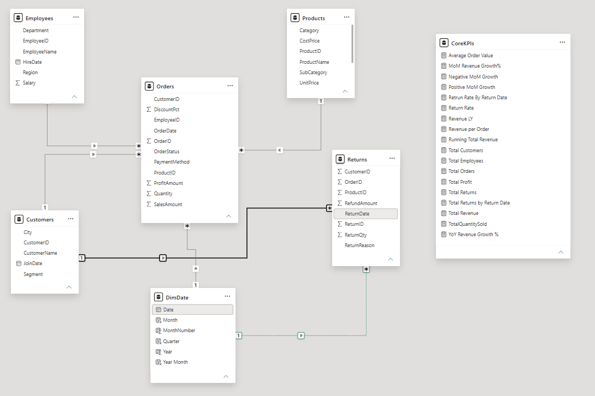
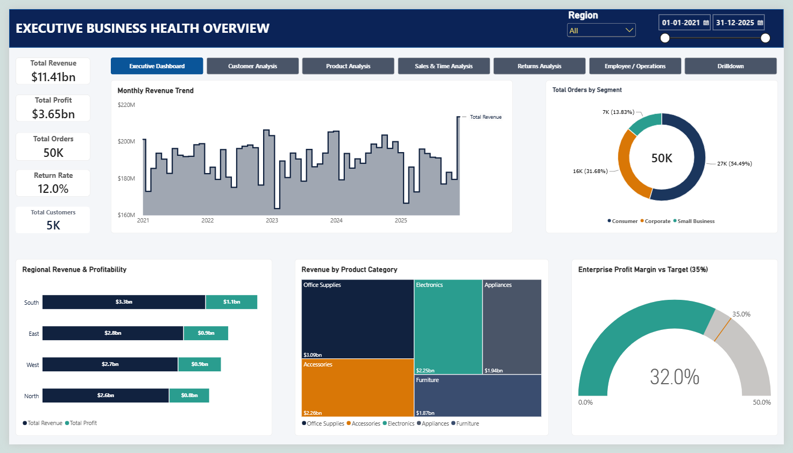
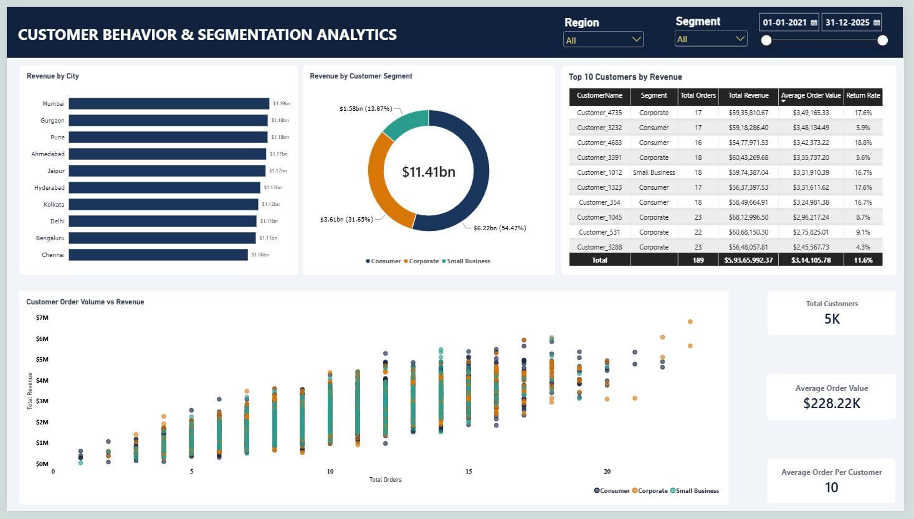
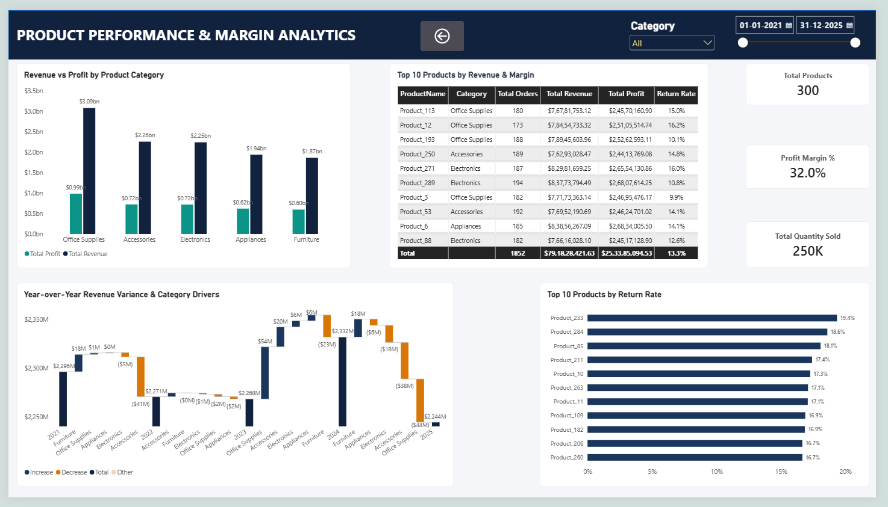
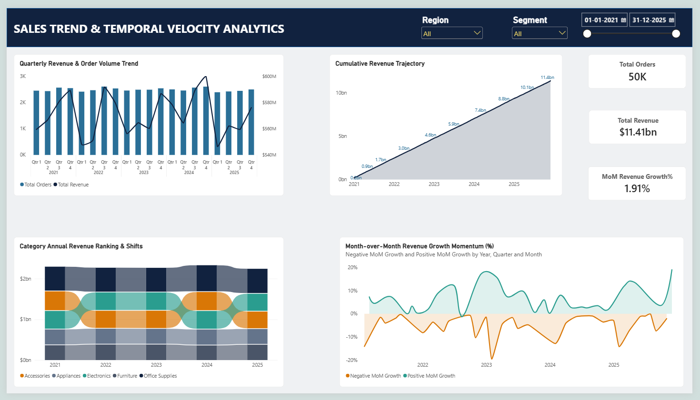
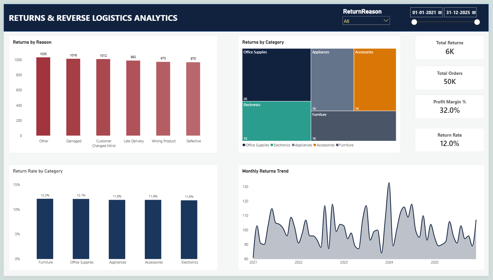
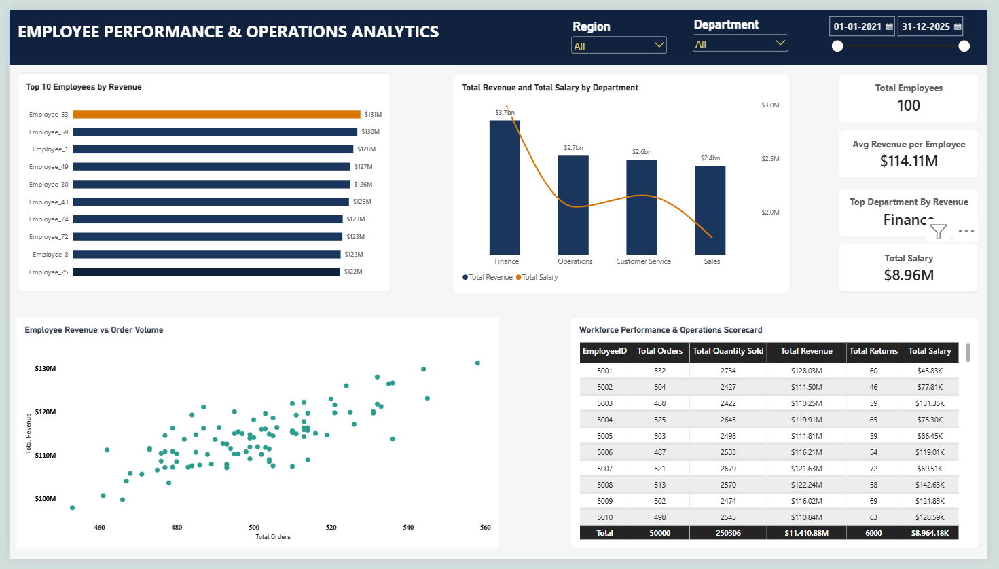
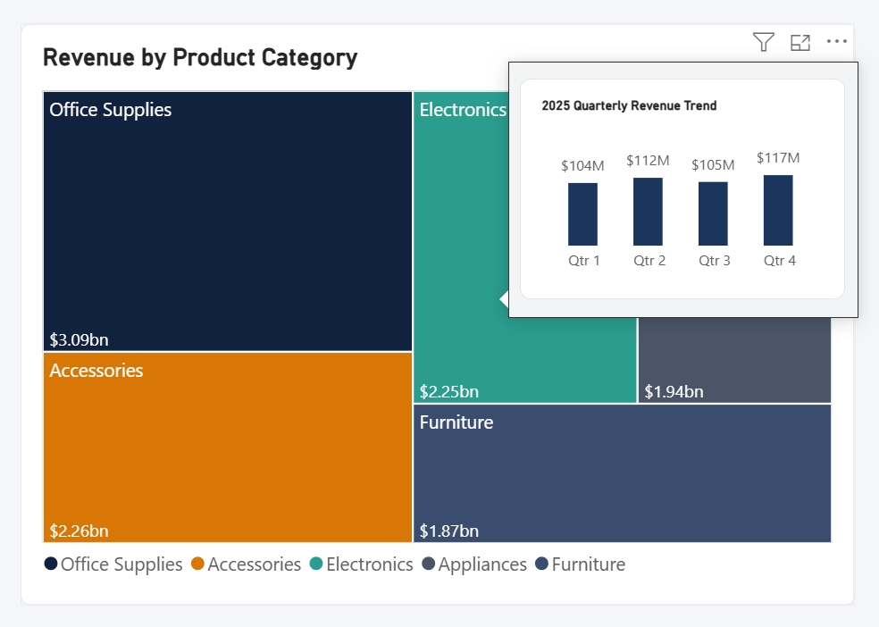

# 📊 Enterprise Commercial & Operational Intelligence Suite

[](https://powerbi.microsoft.com/)
[]()
[]()
[]()
[](https://opensource.org/licenses/MIT)

An end-to-end commercial operations and business intelligence suite built to analyze **$11.41 Billion in cumulative gross revenue**, **$3.65 Billion in bottom-line profits**, and **50,000 multi-region order fulfillment lifecycles** across a 5-year timeline (2021–2025).

---

## 🎯 1. Business Problem & Project Objective

Multi-category commercial retail businesses face critical visibility gaps when scaling operations across fragmented channels:
- **Margin Blindspots:** Revenue numbers often look healthy at an aggregate level, but leadership lacks visibility into whether categories are hitting the corporate target margin (35.0%) or dragging capital down.
- **Reverse Logistics Margin Leakage:** Product returns eat away bottom-line profits. Without understanding the operational root cause (e.g., transit damage vs. buyer remorse), supply chain leaders cannot fix upstream friction.
- **Workforce ROI & Headcount Productivity:** Tracking labor expenses against sales productivity is essential to ensure operational teams are not overburdened with high order volume that yields sub-par revenue realization.

**Project Goal:**  
Ingest 5 clean relational operational datasets, run 32 business diagnostic SQL queries to validate financial and operational baselines, build an optimized Star-Schema data model in Power BI (Import Mode), and deliver a **7-page interactive reporting suite with a dedicated Drilldown module and custom micro-trend tooltip**.

---

## 🏗️ 2. Data Pipeline Architecture
[Kaggle Relational Tables] (Customers, Products, Employees, Orders, Returns)
│
▼
[SQL Server / Azure SQL] (Data Ingestion & 32 Diagnostic Business Queries)
│
▼ (Import Mode)
[Power BI Data Model] (Star-Schema: 2 Fact Tables, 4 Dimension Tables)
│
▼
[Centralized DAX Engine] (Explicit Business Logic inside CoreKPIs)
│
▼
[7-Page Executive Suite + Tooltip] (Executive, Customer, Product, Sales, Returns, Operations, Drilldown + Micro-Tooltip)
---

## 💡 3. Key Business Insights & Analytical Findings (Audited Numbers)

### 📈 Commercial Health & Profitability
- **Gross Performance:** Total gross revenue reached **$11.41 Billion ($11,410.88M)** with **$3.65 Billion ($3,651.48M)** in gross profit, maintaining an exact **32.0% enterprise profit margin** across all 5 product categories (tracking slightly below the 35.0% C-suite target).
- **Category Dominance:** **Office Supplies** led the portfolio by generating **$3.09 Billion** in revenue and **$988.31 Million** in gross profit. Accessories ($2.26B) and Electronics ($2.25B) formed the secondary volume drivers.
- **Top SKU Drivers (SQL Q16):** Window ranking logic identified top category champions:
  * *Appliances:* `Product_6` ($83.86M)
  * *Electronics:* `Product_289` ($83.77M)
  * *Office Supplies:* `Product_193` ($78.95M)
  * *Accessories:* `Product_53` ($76.95M)
  * *Furniture:* `Product_202` ($75.87M)

### 🔄 Reverse Logistics Friction (12.0% Leakage)
- **Return Volume:** Out of 50,000 completed orders, **6,000 returned shipments** were logged, confirming an overall return rate of **12.00%**.
- **Root-Cause Breakdown (SQL Q25):** Return friction is primarily driven by:
  1. *Other / Unclassified:* 1,035 returns
  2. *Damaged in Transit:* 1,016 returns (indicates warehouse packaging and courier handling risks)
  3. *Customer Changed Mind:* 1,012 returns (post-purchase buyer friction)
  4. *Late Delivery:* 992 returns
  5. *Wrong Product Shipped:* 975 returns
  6. *Defective Goods:* 970 returns

### ⏱️ Temporal Dynamics & Growth Momentum
- **Peak Volume vs. Peak Value:** Peak order volume occurred in **August 2024 (906 orders)**, whereas peak monetary revenue was realized in **December 2025 ($213.53M)** due to higher seasonal ticket sizes.
- **YoY Velocity Shifts (SQL Q22):** Using SQL `LAG()` calculations, annual revenue peaked with a **+2.80% YoY expansion in 2024**, followed by a **-3.75% contraction in 2025**.

### 👥 Workforce Economics & Efficiency Outliers
- **Headcount Productivity:** 100 sales and operations representatives delivered an average of **$114.11M revenue per employee** against a total labor cost of **$8.96M**.
- **Volume Outliers (SQL Q32):** `Employee_97` handled the highest individual volume (**536 orders** generating $113.78M), identifying reps processing high ticket counts with below-average revenue realization.

---

## 🗄️ 4. SQL Diagnostic & Business Validation

Prior to data visualization, 32 comprehensive business diagnostic queries were executed to audit data integrity and test operational hypotheses.

- **Full SQL Script:** [`Retail_Sales_Analysis.sql`](Retail_Sales_Analysis.sql)
- **Techniques Used:** Common Table Expressions (CTEs), Window Functions (`LAG`, `RANK() OVER (PARTITION BY ...)`), Aggregate Joins, `EXISTS` / `NOT EXISTS` subqueries, and Nested `HAVING` filters.

---

## 🏛️ 5. Dimensional Modeling (Star Schema)



- **Facts:** `Orders` (Transactional sales events) and `Returns` (Reverse logistics incidents).
- **Dimensions:** `Customers`, `Products`, `Employees`, and `DimDate`.
- **Central Metric Store:** Dedicated `CoreKPIs` table to store explicit DAX measures, keeping dimension tables clean.

---

## ⚡ 6. Core DAX Calculations

```dax
// 1. Month-over-Month (MoM) Revenue Growth %
MoM Revenue Growth% = 
VAR CurrentRevenue = [Total Revenue]
VAR PreviousMonthRevenue = CALCULATE([Total Revenue], DATEADD('DimDate'[Date], -1, MONTH))
RETURN
    DIVIDE(CurrentRevenue - PreviousMonthRevenue, PreviousMonthRevenue, 0)

// 2. Cumulative Revenue Trajectory
Running Total Revenue = 
CALCULATE(
    [Total Revenue],
    FILTER(
        ALLSELECTED('DimDate'[Date]),
        'DimDate'[Date] <= MAX('DimDate'[Date])
    )
)

// 3. Operational Return Rate %
Return Rate = 
DIVIDE([Total Returns], [Total Orders], 0)

// 4. Enterprise Profit Margin %
Profit Margin % = 
DIVIDE([Total Profit], [Total Revenue], 0)
```
## 🖥️ 7. Power BI Dashboard Architecture (7 Core Analytical Pages + 1 Custom Tooltip)
Page 1: Executive Business Health Overview   

Executive KPI scorecard, 5-Year Monthly Revenue Velocity trendline, Segment Order Distribution Donut, Geographic Revenue & Profitability, Category Treemap, and Enterprise Profit Margin vs Target Gauge (32.0% Actual vs 35.0% Target). 

Page 2: Customer Behavior & Segmentation Analytics  

Metro-city sales concentration (Mumbai, Gurgaon, Pune, Ahmedabad), Customer Segment volume split (Corporate 54.49%), Top 10 Accounts table, and Order Volume vs Revenue Scatter Matrix.

Page 3: Product Performance & Margin Analytics

Category Revenue vs Profit distribution, Top 10 Products by Revenue & Margin, Category YoY Waterfall Variance, and SKU Return Rate rankings.

Page 4: Sales Trend & Temporal Velocity Analytics  

Dual-axis Quarterly Volume & Revenue combo chart, 5-Year Cumulative Trajectory area visual, and MoM Revenue Growth Momentum differential curve.

Page 5: Returns & Reverse Logistics Analytics  

Return Reason bar ranking (Damaged, Mind Changed, Delays), Category Return Treemap, Category Return Rate bars, and Monthly Return Incident tracking over time.

Page 6: Employee Performance & Operations Analytics   

Top Revenue-Generating Reps, Departmental Revenue vs Total Salary line ($8.96M total payroll cost), Individual Order Volume vs Revenue correlation, and Workforce Performance Scorecard.

Page 7: Contextual SKU & Margin Drilldown
Dedicated page-to-page drill-through audit page linked across all navigation menus and categorical charts, preserving active filter contexts for deep-dive analysis.  

---

## 🔬 8. Advanced UX & Interactive Features

### Custom Report-Page Tooltip (`Tooltip_Category`)

- Hovering over any category block on the Executive Treemap dynamically renders category-level micro-trends and quarterly revenue velocity (FY2025 Q1–Q4) in real time without cluttering canvas real estate.

### Contextual Navigation & Design System
- **Drilldown Routing:** Right-clicking any category item enables cross-report drill-through directly into granular SKU & Margin analysis on Page 7, preserving all active slicer filter contexts.
- **WCAG-Compliant Enterprise Theme:**
  * **Primary Accent:** Corporate Navy (`#11223F`)
  * **Target & Health Accent:** Slate Teal (`#2A9D8F`)
  * **Alert Accent:** Warm Amber (`#D97706`)
  * **Canvas Neutral:** Light Slate Grey (`#F4F6F9`) with pure white containers (`#FFFFFF`).

---

## 🚀 9. Setup & Local Reproduction

1. **Clone the Repository:**
   ```bash
  git clone https://github.com/singhsaurabhhh16-lang/Enterprise-PowerBI-Commercial-Suite.git
  
1.Review Database Diagnostics: Open and execute Retail_Sales_Analysis.sql in SQL Server Management Studio (SSMS) or Azure Data Studio.
2.Launch the BI Report: Open Sales_Analysis.pbix in Power BI Desktop.   
